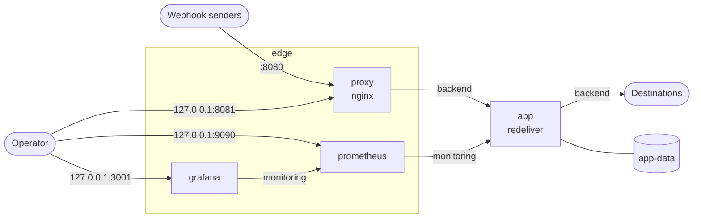

# redeliver-stack

[](https://github.com/rezarg-dev/redeliver-stack/actions/workflows/ci.yml)


A Docker Compose deployment for [redeliver](https://github.com/rezarg-dev/redeliver),
a self-hosted webhook relay. One command builds the application image and
starts it behind an nginx reverse proxy, with Prometheus, Grafana, alert
rules and database backups.

The application itself is a single Node.js process. This repository is about
everything around it: how it is packaged, what is reachable from where, how
it is observed, and how its data is kept safe.


---

## Support the Project

If redeliver-stack has been useful to you, you can support its development:

| Network | Address |
| :---: | :---: |
| **USDT (BEP20)** | `0x8F540B43cC82d765bfe33c7B3da042B11708eCD1` |
| **USDT (TRC20)** | `TGHxjiBeBkdJ7v2Vc4gqE9FYp7Nj1sgDkJ` |
| **Litecoin (LTC)** | `ltc1q28g9qzpjs22x2uvds5tqp60w250fvjf2te234l` |

Every contribution, no matter the size, helps keep this project alive. ❤️

---

## What is in the box

| Service | Image | Role |
| --- | --- | --- |
| `app` | built from [app/Dockerfile](app/Dockerfile) | redeliver itself, state in a named volume |
| `proxy` | `nginxinc/nginx-unprivileged` | The only public entry point: rate limiting, size limit, path allow-list |
| `prometheus` | `prom/prometheus` | Scrapes the app, evaluates the alert rules |
| `grafana` | `grafana/grafana` | Dashboard, provisioned from files in this repository |
| `receiver`, `traffic` | same image as `app` | `demo` profile: a fake destination and a traffic generator |
| `backup` | built from [backup/Dockerfile](backup/Dockerfile) | `tools` profile: one-shot database snapshot |

## Quick start

You need Docker with the Compose plugin (v2.20 or newer; Docker Desktop
includes it), `make`, and `openssl` for generating the secrets.

```bash
git clone https://github.com/rezarg-dev/redeliver-stack.git
cd redeliver-stack
make demo
```

`make demo` generates the secrets, builds the images, starts everything and
returns once all health checks pass. Then:

| What | Where |
| --- | --- |
| Dashboard | <http://localhost:3001>, user `admin`, password in `secrets/grafana_admin_password` |
| Prometheus | <http://localhost:9090> (alerts under *Alerts*) |
| Admin API | `http://localhost:8081/api/...`, token from `make token` |
| Webhook ingest | `http://localhost:8080/in/<source id>` |

The demo profile registers a source, points it at a fake destination and
keeps sending webhooks to it. A few of them are deliberately wrong (bad
signature, repeated idempotency key), so every panel of the dashboard gets
data within a minute.

A good way to see what the stack is for:

```bash
docker compose stop receiver     # the destination goes down
# watch "Waiting" grow and attempts turn into retries on the dashboard
docker compose start receiver    # it comes back
# the queue drains by itself, nothing was lost
```

Use `make up` instead of `make demo` to start without the demo services,
`make down` to stop, and `make clean` to also delete the data.

```
$ make help
  help      Show this help
  init      Create .env and generate the secrets (safe to repeat)
  up        Build and start the stack, wait until everything is healthy
  demo      Like "up", plus a fake destination and generated traffic
  down      Stop and remove the containers, keep the data
  clean     Stop everything and delete all data volumes
  ps        Show the state of the services
  logs      Follow the logs of all services
  token     Print the admin API token
  backup    Write a database snapshot to ./backups
  restore   Restore a snapshot: make restore FILE=backups/<name>.db.gz
  smoke     Check a running stack from the outside
  lint      Validate the compose file, Dockerfiles, scripts and Prometheus config
```

## The image

[app/Dockerfile](app/Dockerfile) does not contain or copy the application
from this repository. The source arrives through a *named build context*
that `compose.yaml` points at the redeliver git repository:

```yaml
build:
  context: ./app
  additional_contexts:
    source: https://github.com/rezarg-dev/redeliver.git#${REDELIVER_REF:-main}
```

That keeps deployment and application in separate repositories without git
submodules or a registry in between. `REDELIVER_REF` in `.env` selects the
branch, tag or commit to deploy.

Other things worth pointing out:

- **Two stages.** Dependencies are installed in the first stage with
  `npm ci --omit=dev`; the final image gets `node_modules` and the source,
  but no npm cache and no development tools.
- **Layer order.** The manifests are copied before the source, so the
  dependency layer is reused until `package-lock.json` changes.
- **Not root.** The process runs as uid 1000 and can only write to `/data`.
- **Health check without extra tools.** The image has no curl; the check is a
  one-line `fetch()` in Node.
- **Secrets stay out of the environment.** See below.

## What is reachable from where

The app has an admin API, a health endpoint and a metrics endpoint. None of
them should be on the internet. Instead of relying on a firewall rule that
someone has to remember, the proxy has two listeners:

| Listener | Published on | Paths | Everything else |
| --- | --- | --- | --- |
| 8080, public | all interfaces | `/in/*` | 404 |
| 8081, admin | `127.0.0.1` only | `/api/*`, `/healthz` | 404 |

`/metrics` is not proxied at all. Prometheus scrapes the app directly over
an internal network.

The containers are attached to three networks:

| Network | Members | Purpose |
| --- | --- | --- |
| `edge` | proxy, prometheus, grafana | Services with a published port |
| `backend` | proxy, app (and the demo services) | Proxy to app. Not internal, because the app has to reach destinations on the internet |
| `monitoring` | app, prometheus, grafana | Scraping and queries. `internal: true`, so no route to the outside |

Prometheus and Grafana are not on `backend`, so they cannot call the admin
API, and the proxy is not on `monitoring`, so it cannot reach Prometheus.

On the public listener nginx also enforces

- a **rate limit** of 20 requests per second per client address with a burst
  of 40 (`429` beyond that), and
- a **body size limit** of 256 KiB, the same as the app's own limit, so
  oversized requests are rejected before they are forwarded.

## Container hardening

Applied to every long-running service through one YAML anchor in
`compose.yaml`:

| Setting | Effect |
| --- | --- |
| `cap_drop: [ALL]` | No Linux capabilities. Nothing here needs any: all ports are above 1024 |
| `no-new-privileges` | A process cannot gain privileges through setuid binaries |
| Non-root users | app: 1000, nginx: 101, Prometheus: nobody, Grafana: 472 |
| `read_only: true` | Root filesystem is read-only for app, proxy, Prometheus and the demo services. Writes go to a volume or a tmpfs |
| Resource limits | CPU and memory caps per service |
| Log rotation | `json-file` with 3 files of 10 MB each, so logs cannot fill the disk |
| `restart: unless-stopped` | Services come back after a crash or a reboot |

Grafana is the exception to `read_only`. I have not verified which paths it
writes to at runtime, and a dashboard that fails to start is worse than a
writable root filesystem.

### Secrets

`make init` writes two random secrets to `secrets/` (ignored by git): the
admin API token and the Grafana admin password. Compose mounts them into the
containers as files under `/run/secrets`.

Grafana can read a password from a file natively. redeliver only reads
`ADMIN_TOKEN` from its environment, so the image has a small
[entrypoint](app/docker-entrypoint.sh) that reads `ADMIN_TOKEN_FILE` and
exports its content just before starting Node. The token therefore never
appears in `compose.yaml`, in `.env` or in the output of `docker inspect`.

## Monitoring

Grafana starts with the Prometheus data source and the dashboard already in
place; both are provisioned from `monitoring/grafana/`. The dashboard shows

- webhooks accepted per minute and the delivery success rate,
- how many deliveries are waiting and how many have been given up on,
- accepted webhooks by source, rejected and duplicate webhooks by reason,
- delivery attempts by outcome and deliveries by state over time.

Alert rules live in
[monitoring/prometheus/rules/redeliver.yml](monitoring/prometheus/rules/redeliver.yml):

| Alert | Fires when | Severity |
| --- | --- | --- |
| `RedeliverDown` | The app has not answered scrapes for 1 minute | critical |
| `DeadDeliveries` | At least one delivery has used up all its attempts | warning |
| `DeliveryBacklogGrowing` | More than 100 deliveries waiting, and rising for 10 minutes | warning |
| `MostDeliveryAttemptsFail` | Over half of all attempts failed for 10 minutes | warning |
| `SignatureFailures` | More than one wrongly signed webhook per second for 5 minutes | warning |

The rules have unit tests in
[monitoring/prometheus/tests](monitoring/prometheus/tests/alerts_test.yml)
that feed in synthetic series and check which alerts fire and with which
text. For example, a queue of 900 that is draining must stay quiet while a
queue of 550 that is growing must alert. `make lint` runs them with
`promtool`.

There is no Alertmanager in the stack. Alerts are visible in the Prometheus
UI; routing them to e-mail or chat is the next step if this runs for real.

## Backups

The database is a SQLite file in the `app-data` volume, in WAL mode. Copying
that file while the app is running can produce a broken copy and misses what
is still in the write-ahead log. `make backup` therefore runs a short-lived
container that uses SQLite's online backup API:

```bash
$ make backup
backup: wrote /backups/redeliver-20261116T223825Z.db.gz (8912 bytes)
```

It verifies the snapshot with `PRAGMA integrity_check`, compresses it into
`./backups`, and deletes all but the newest `BACKUP_KEEP` snapshots. The app
keeps running the whole time. To take one every night, call it from cron:

```
0 3 * * *  cd /srv/redeliver-stack && make backup
```

Restoring stops the app, checks the snapshot, swaps the file and starts the
app again:

```bash
make restore FILE=backups/redeliver-20261116T223825Z.db.gz
```

## Configuration

`make init` copies `.env.example` to `.env`. Every value has a default.

| Variable | Default | Description |
| --- | --- | --- |
| `REDELIVER_REF` | `main` | Branch, tag or commit of redeliver to build |
| `LOG_LEVEL` | `info` | Log level of the app |
| `PUBLIC_PORT` | `8080` | Host port for webhook ingest |
| `ADMIN_PORT` | `8081` | Host port for the admin API (bound to 127.0.0.1) |
| `PROMETHEUS_PORT` | `9090` | Host port for Prometheus (bound to 127.0.0.1) |
| `GRAFANA_PORT` | `3001` | Host port for Grafana (bound to 127.0.0.1) |
| `PROMETHEUS_RETENTION` | `15d` | How long metrics are kept |
| `BACKUP_KEEP` | `14` | Number of snapshots to keep |

## Checks

```bash
make lint     # compose file, Dockerfiles (hadolint), shell scripts (shellcheck),
              # Prometheus config and alert rule tests (promtool)
make smoke    # against a running stack
```

`make smoke` talks to the stack the way the outside world does. It checks
that the admin API, the health check and the metrics are *not* reachable on
the public port, that the admin API rejects requests without the token, that
a webhook sent to the public port ends up in the app, that an oversized one
is refused by the proxy, and that Prometheus is scraping the app.

The GitHub Actions workflow runs `make lint`, then starts the whole stack on
the runner, runs the smoke test, takes a backup, restores it and runs the
smoke test again.

## Layout

```
compose.yaml                the stack
app/                        Dockerfile and entrypoint for the redeliver image
proxy/nginx.conf            both listeners, rate and size limits
monitoring/prometheus/      scrape config, alert rules and their tests
monitoring/grafana/         provisioned data source and dashboard
backup/                     image and script for database snapshots
demo/traffic.js             traffic generator for the demo profile
scripts/                    init, smoke test, restore
docs/operations.md          day-to-day tasks and what to do when an alert fires
```

## Limitations

- **No TLS.** The proxy speaks plain HTTP. On a real host, put it behind
  something that terminates TLS (a load balancer, Caddy, or nginx with
  certificates) and publish `PUBLIC_PORT` only to that.
- **Single host.** This is Compose, not an orchestrator. The app keeps its
  state in a local SQLite file and cannot be scaled to several replicas.
- **Rate limiting is per client address.** Behind another proxy or a NAT all
  requests appear to come from one address; the limit then has to move to
  that proxy or use a forwarded header.
- **Backups stay on the same machine** unless you copy `./backups` somewhere
  else.
- **Snapshots are written by root** on Linux, because the backup container
  needs to read a volume owned by another user.

## License

[MIT](LICENSE)
